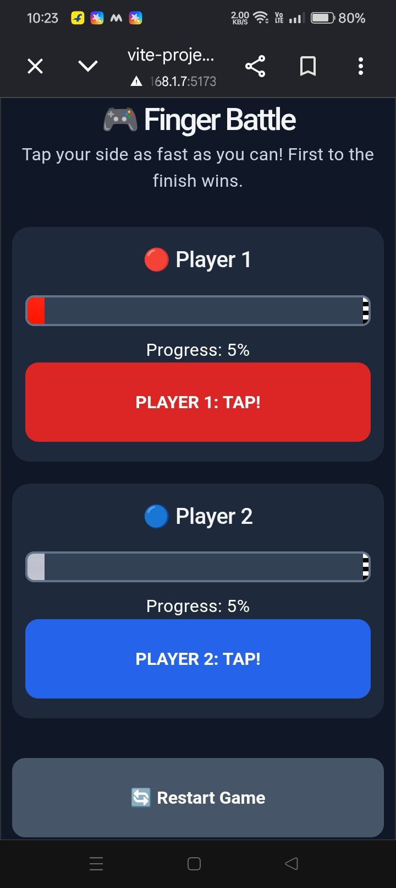

# 🎮 Finger Battle — React

## 📌 How I Got the Idea

While learning React, I learned about the `useState` Hook. First, I made a small component where I could change the height and width of an image using buttons.

For example, I used `useState` to store the width of an image and increase it when I clicked a button.

```jsx
const [width, setWidth] = useState(100);

function increaseWidth() {
  setWidth((prevWidth) => prevWidth + 10);
}
```

This helped me understand how React updates the UI when a state value changes.

Then I thought, why not use the same idea to make a small game?

That's how I got the idea of making **Finger Battle**, a simple game for two players.

In this game, both players press their own buttons to increase the width of their strips. Each press increases the width by 5px. The first player to reach 100px wins the game.

I used a red strip for Player 1 and a white strip for Player 2.

## 🎯 Game Rules

- Player 1 controls the red strip.
- Player 2 controls the white strip.
- Both strips start with a width of 5px.
- Each button press increases the strip's width by 5px.
- The first player to reach 100px wins.
- Both players can try to press their buttons at the same time.

## 🖼️ Game Output

This is the full view of my game.




## 🟥 Red Strip

This is the red strip for Player 1. Its width increases every time the player presses the button.

<!-- Add your red strip screenshot here -->


## ⬜ White Strip

This is the white strip for Player 2. It works in the same way as the red strip.

<!-- Add your white strip screenshot here -->


## ⚙️ Technologies Used

- React
- JavaScript
- HTML
- CSS
- Vite

## 🧠 What I Learned

My main goal was to understand the `useState` Hook better and learn how to use it in a real project.

While making this game, I faced a problem. I wanted both players to press their buttons at the same time, but it did not work as I expected.

I used AI to help me solve this problem. After that, I started learning how the solution worked and what I needed to understand to make it work properly.

This project helped me learn more about state updates, button events, and handling multiple inputs.

I enjoyed making this game because I was learning by building something of my own instead of only following examples.

## 🚀 How to Run

**1. Clone the repository**

```bash
git clone https://github.com/priyadarshanpratyush1125-beep/Finger-Battle-React.git
```

**2. Open the project folder**

```bash
cd Finger-Battle-React
```

**3. Install the required packages**

```bash
npm install
```

**4. Start the project**

```bash
npm run dev
```

Open the local URL shown in your terminal to play the game.

## 📱 Play on Mobile

Want to play Finger Battle on your mobile phone using multitouch?

👉 [Click here to learn how to run the game on mobile](how_to_run_on_mobile.md)

## 🔮 Future Improvements

- Add a restart button.
- Show the winner on the screen.
- Improve the game design.
- Make it easier to play on mobile phones.
- Add a score or timer.

## 👨‍💻 About This Project

Finger Battle is a small React project I made while learning React Hooks.

It started with a simple experiment to change an image's size. Then I got the idea of turning it into a two-player game.

I made this project out of curiosity and to understand React better by building something myself.

**Started with a simple idea, learned something new, and turned it into a game!** ❤️


